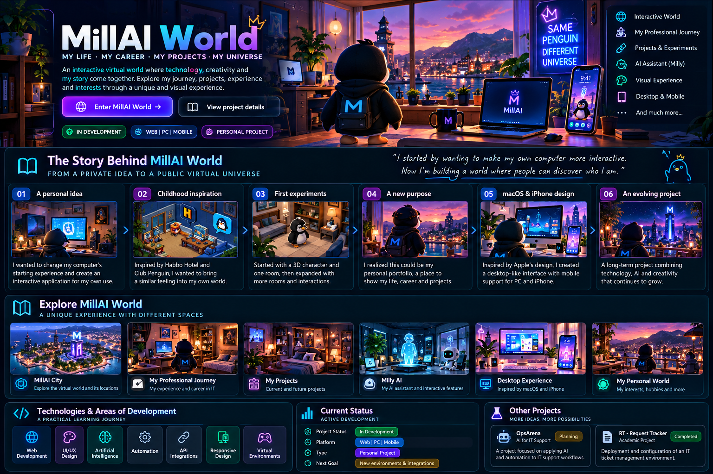

### 👨‍💻 Enterprise IT · Endpoint Management · Automation & AI

**Microsoft Intune · SCCM/MECM · PowerShell · Azure**

📍 Asturias, Spain

 

---

## 👨‍💻 ABOUT ME

> ### Hello, I'm Miguel! 👋
>
> I'm an IT professional with **more than three years of experience** in enterprise technical support, endpoint management and IT operations.
>
> My professional experience spans **L1, L2 and L3 support**, with hands-on work involving Microsoft Intune, SCCM/MECM, PowerShell, Active Directory, Azure and ServiceNow.
>
> I've worked in enterprise environments involving banking, infrastructure, environmental services and logistics.
>
> I'm currently expanding my knowledge of **artificial intelligence, automation, Python, APIs, cloud and cybersecurity**.
>
> Alongside my IT career, I'm building **MillAI World**, an interactive virtual universe that brings together my professional journey, personal interests and projects.

---

<h2><a href="https://millai.mintypeach7.chatgpt.site/">🌍 MILLAI WORLD — MY DIGITAL UNIVERSE (Click on the link) </a></h2>

Conceptual illustration — MillAI World is under active development.

### 🐧 One Penguin. One World. My Entire Story.

**What if a personal portfolio became a virtual world you could explore?**

  

---

## ✨ WHAT IS MILLAI WORLD?

> ### 🐧 A Different Way to Introduce Myself
>
> **MillAI World is my interactive personal universe.**
>
> Instead of presenting my story through a traditional CV or static website, I'm creating a virtual world where visitors can explore my life, professional experience, projects and interests.
>
> The main character is a **moving penguin** that navigates virtual environments, discovers different rooms and interacts with the world.
>
> The project combines the nostalgia of childhood virtual games with modern interface design, technology and artificial intelligence.
>
> **Don't just read about my story. Explore it.**

---

## 📖 THE STORY BEHIND MILLAI WORLD

**FROM A PRIVATE IDEA TO A PUBLIC VIRTUAL UNIVERSE**

*How a small personal experiment became my most ambitious creative project.*

### 🗺️ Explore the Chapters

| Chapter | The Story |
|---|---|
| 💡 **01** | The Original Idea |
| 🎮 **02** | The Games That Inspired Me |
| 🏠 **03** | The First Room |
| 🐧 **04** | The Penguin |
| 🌍 **05** | The Idea That Changed Everything |
| 🍎 **06** | macOS & iPhone Inspiration |
| 🛠️ **07** | The Development Journey |
| ❤️ **08** | Why I'm Building This |

*Click each chapter to expand its story.*

<b>💡 CHAPTER 01 — THE ORIGINAL IDEA</b>

### It Was Never Supposed to Be Public

MillAI World started as a completely private project.

I wasn't planning to create a professional portfolio or a public website.

**I simply wanted to change how I interacted with my own computer.**

The original concept was an application that would launch automatically when I turned on my PC.

Instead of accessing everything through traditional windows, folders and desktop icons, I imagined a virtual environment controlled by a character.

Each room would represent a different function of my computer.

| Virtual Room | Original Purpose |
|---|---|
| 🌐 Browser | Open and use the web browser |
| 📁 Documents | Access local documents |
| 🎵 Music | Control music and multimedia |
| 💬 Communication | Access connected services |
| ⚙️ Settings | Manage application preferences |
| 🤖 AI | Interact with a personal assistant |

The goal was to create something similar to a **small operating-system-like experience inside an application**.

Not to replace Windows, but to give my computer a completely different interface.

At that point, the project was intended only for my own use.

<b>🎮 CHAPTER 02 — THE GAMES THAT INSPIRED ME</b>

### A Little Piece of My Childhood

Two games played a particularly important role in shaping my vision.

**Habbo Hotel** fascinated me with its isometric rooms, furniture, social environments and freedom to explore and customize virtual spaces.

**Club Penguin** gave me the experience of exploring an entire world through a penguin character, discovering locations and interacting with the environment.

Both games were an important part of my childhood.

I wanted to recover that feeling of exploration and bring it into something personal, combining nostalgic inspiration with modern functionality.

The project is not intended to recreate those games, but to build an independent universe inspired by what made them memorable.

<b>🏠 CHAPTER 03 — THE FIRST ROOM</b>

### Every World Has to Start Somewhere

The first experiments were much simpler than the world I'm developing today.

The project started around a character conceived with a 3D modelling approach and a small virtual environment.

Initially, the focus was on a room and the idea of creating additional interconnected spaces.

Each room would have its own purpose, appearance and functionality.

I began exploring movement, room layouts and ways of turning ordinary computer tasks into virtual interactions.

**One character. One room. One idea.**

What began as a small experiment gradually became a much larger project.

<b>🐧 CHAPTER 04 — THE PENGUIN</b>

### Meet the Main Character

The penguin became the main character of MillAI World.

Its design direction was influenced by the virtual worlds I enjoyed during my childhood, especially Club Penguin.

I wanted visitors to experience the world by controlling a recognizable character rather than navigating only through conventional menus.

The experience is centered around:

- 🐧 Penguin movement and animation
- 🏠 Navigation between rooms
- 🌍 Exploration of virtual environments
- 🖱️ Interaction with objects and interfaces
- 🚪 Discovering spaces connected to my personal story
- ✨ A more playful and memorable experience

Developing movement, interactions and animations is an important part of the project.

**The penguin gives MillAI World its own identity.**

<b>🌍 CHAPTER 05 — THE IDEA THAT CHANGED EVERYTHING</b>

### What If My Portfolio Was a Virtual World?

During development, I began to see the project from a different perspective.

The original idea was to create an interactive environment for my computer.

Then I realized that the same world could become a unique way to introduce myself to other people.

**What if my personal and professional story could be explored like a virtual adventure?**

My professional career could become a collection of interactive environments.

My projects could have their own rooms.

My education and personal interests could become part of the world.

Instead of reading a conventional CV, visitors could explore the different aspects of my life.

That was the turning point.

**MillAI World evolved from a private desktop experiment into a public interactive portfolio.**

<b>🍎 CHAPTER 06 — MACOS & IPHONE INSPIRATION</b>

### Combining Virtual Worlds with Modern Interfaces

As the project evolved, I wanted to introduce another of my interests: Apple's approach to user interface design.

I've always been particularly interested in macOS and iPhone interfaces, including their visual organization, transitions and overall user experience.

The new direction was to create a web application with a desktop-inspired experience combined with a virtual world.

The design vision includes:

| Element | Design Direction |
|---|---|
| 🖥️ Desktop | macOS-inspired interface |
| 📱 Mobile | iPhone-inspired elements |
| 🪟 Windows | Desktop-style panels |
| 🚀 Launcher | Application navigation |
| 🐧 Virtual World | Interactive exploration |
| ✨ Transitions | Smooth navigation and animation |

The aim is to support desktop and mobile devices while preserving the character of the experience.

MillAI World is an independent personal project and is not affiliated with Apple, Habbo or Club Penguin.

<b>🛠️ CHAPTER 07 — THE DEVELOPMENT JOURNEY</b>

### The Details Take More Time Than You Imagine

Developing MillAI World has been a much longer process than I originally expected.

Creating a virtual world involves much more than designing rooms.

It requires work on:

- 🎨 Visual assets, buildings and environments
- 🐧 Penguin movement, animation and interaction
- 🏠 Room layouts, navigation and object placement
- 💻 Application structure and code organization
- 📱 Responsive design and mobile usability
- 🔗 Integrations, APIs and connected services
- 🧪 Testing, troubleshooting and continuous refinement

Sometimes a small visual change leads to reviewing several parts of the application.

Correcting overlapping elements, movement problems, inconsistent designs and interface behaviour takes time.

But the process is also incredibly rewarding.

Every improvement brings the project closer to the experience I imagined.

**Building MillAI World is also helping me develop new technical skills through practical experimentation.**

<b>❤️ CHAPTER 08 — WHY I'M BUILDING THIS</b>

### More Than a Portfolio

MillAI World brings together several things that genuinely interest me:

Technology, video games, virtual environments, design, artificial intelligence and creative experimentation.

It is an opportunity to keep learning while creating something personal.

My goal is to build a place where my career, education, projects, interests and future ambitions can coexist.

I want visitors to understand who I am through an experience that feels different from reading a traditional CV.

Not simply a collection of dates, company names and responsibilities.

**An interactive world that reflects my story.**

What started as an experiment for my own computer is gradually becoming something I can share with other people.

> I started by wanting to make my computer more interactive. Now I'm building a world where people can discover who I am.

---

## 🗺️ THE EVOLUTION OF MILLAI WORLD

| Stage | Milestone | Evolution |
|:---:|---|---|
| 💡 01 | Original Idea | A private interactive desktop application |
| 🎮 02 | Inspiration | Habbo Hotel and Club Penguin |
| 🏠 03 | First Experiments | A character and connected virtual rooms |
| 🐧 04 | The Penguin | A moving character became the protagonist |
| 🌍 05 | Public Vision | An interactive personal portfolio |
| 🍎 06 | Desktop Experience | macOS and iPhone-inspired design |
| 📱 07 | Web Experience | Development for PC and mobile |
| 🤖 08 | AI Exploration | Assistants, services and automation |
| 🚀 09 | Future | New environments and interactive experiences |

---

## 🏙️ EXPLORE THE UNIVERSE

| 🐧 Virtual Experience | 🌟 What It Represents |
|---|---|
| 🐧 **The Penguin** | The main character exploring the world |
| 🏙️ **MillAI City** | Virtual environments, locations and buildings |
| 💼 **Professional Journey** | My experience in enterprise IT |
| 🎓 **Education** | My academic background and training |
| 🚀 **Projects** | Software, IT and AI initiatives |
| 🧑 **Personal World** | My personal interests and experiences |
| 🤖 **Milly AI** | My vision for a personalized AI assistant |
| 🖥️ **Desktop** | A desktop-inspired interface |
| 🌐 **Future Worlds** | New locations and interactive features |

*The project is under active development. Some areas are part of the current experience, while others form part of the development roadmap.*

---

## 📸 DEVELOPMENT GALLERY

| 🐧 The Penguin | 🏙️ MillAI City |
|---|---|
| Main character, movement and interactive exploration. **Screenshots coming soon.** | Virtual locations, rooms and environments. **Screenshots coming soon.** |
| 🖥️ Desktop Interface | 📱 Mobile Experience |
| macOS-inspired application design. **Screenshots coming soon.** | Responsive layouts and mobile interface. **Screenshots coming soon.** |

---

## 🚧 CURRENT DEVELOPMENT STATUS

> ### 🟢 Active Development
>
> MillAI World is an evolving personal project.
>
> Development efforts focus on visual consistency, interactive environments, character navigation, responsive interfaces and application functionality.
>
> ### 🔮 Future Vision
>
> The long-term vision includes additional environments, richer interactions, AI assistance, connected services and an increasingly complete personal universe.
>
> **Planned features are not presented as completed functionality until implemented and tested.**

---

## 💼 PROFESSIONAL EXPERIENCE

**Enterprise IT Support · Endpoint Management · Service Desk Operations**

### 🏢 DXC Technology Spain, S.A.

My experience at DXC Technology includes several corporate client environments, technical support assignments and endpoint management responsibilities.

### 🏦 Cajamar Bank Group

> **IT L3 — Device Management Operator** · January 2024 – August 2024
>
>   
>
> - Microsoft Intune and SCCM/MECM administration
> - Software packaging and application deployments
> - PowerShell automation and technical scripting
> - Kiosk mode, OMA-URI and Proactive Remediation
> - Endpoint troubleshooting and technical documentation
> - Device management operations involving more than **1,000 ATMs**

### 🏗️ FCC Group

> **IT Support L1/L2 → Service Desk Coordination** · August – December 2024 | June 2025 – September 2026
>
>  
>
> **First stage — Technical Support**
> - Enterprise L1/L2 user assistance
> - Approximately 50 daily support interactions
> - Incident resolution and escalation management
> - Ticket queues, SLAs and technical documentation
> - Support in Spanish and English
>
> **Second stage — Operational Coordination**
> - Greater responsibility in service desk operations
> - Queue monitoring, incident prioritization and escalations
> - Coordination in an environment involving approximately 60 agents
> - Documentation and operational follow-up

### 📦 Logista Group

> **IT Support & Operational Coordination** · January 2025 – May 2025
>
>  
>
> - End-user support and incident resolution
> - Operational issue management in a logistics environment
> - Coordination of distribution and messaging incidents
> - SLA-oriented technical assistance
> - High-volume periods exceeding **100 daily interactions**

### 💻 TEKA & EDPR

> **L3 Endpoint & Device Support**
>
>  
>
> - Microsoft Intune and SCCM/MECM operations
> - Device configuration, compliance and security policies
> - Application and operating system deployments
> - Deployment rings and endpoint troubleshooting
> - Enterprise device administration

### 🎓 My First Steps — DXC Internship

> **Higher Vocational Training Internship — ASIR** · April – June 2023 | Approximately 380 hours
>
> My first enterprise IT experience included Microsoft Azure and Intune, desktop and mobile device management, Windows deployment and device preparation, BIOS configuration, technical troubleshooting, reporting and support operations.

---

## 🛠️ TECHNICAL EXPERTISE

### 💻 Endpoint Management

  

### ☁️ Systems & Cloud

  

### ⚙️ Automation & IT Service Management

  

### 📚 Currently Learning

   

---

## 🚀 OTHER PROJECTS

| 🤖 OpsArena — AI for IT Support | 🎫 RT — Request Tracker |
|---|---|
| **Status: Planning** | **Status: ASIR academic project** |
| A planned project exploring AI-assisted support workflows: incident classification, knowledge base integration, automated troubleshooting, PowerShell/Python and APIs. | A ticket management environment using Ubuntu VMs, Apache, MySQL, Request Tracker, virtual networks, roles and ticket workflows. |

---

## 🎓 EDUCATION & CONTINUOUS LEARNING

### 🎓 Higher Vocational Training — ASIR

**Administración de Sistemas Informáticos en Red**

Advanced vocational training in networked computer systems administration.

### 🧠 Current Technical Learning

| Area | Learning Focus |
|---|---|
| 🤖 Generative AI | Language models and AI foundations |
| 🐍 Python | Programming and automation |
| 🔗 APIs | Application and service integrations |
| 🧠 AI Agents | Intelligent workflows and assistants |
| ☁️ Cloud | Microsoft cloud technologies |
| 🛡️ Cybersecurity | Security and endpoint protection |
| 💻 Modern Workplace | Enterprise endpoint administration |

**Learning through practical projects, technical documentation and continuous experimentation.**

---

## ⚽ BEYOND TECHNOLOGY

Technology is my profession, but my interests go beyond IT.

I'm passionate about football, virtual worlds, interactive experiences and the opportunities created by artificial intelligence.

One of my professional ambitions is to explore opportunities where technology and football come together.

MillAI World also provides a place to represent my personal interests within a creative environment.

---

## 🎯 PROFESSIONAL DIRECTION

**Modern Workplace · Endpoint Engineering · Systems Administration**

**IT Automation · AI Applied to IT · Enterprise Technology**

---

## 🤝 LET'S CONNECT

**Interested in my experience or projects?**

### 🐧 Thanks for visiting my GitHub profile!

*My life. My career. My projects. My world.*

